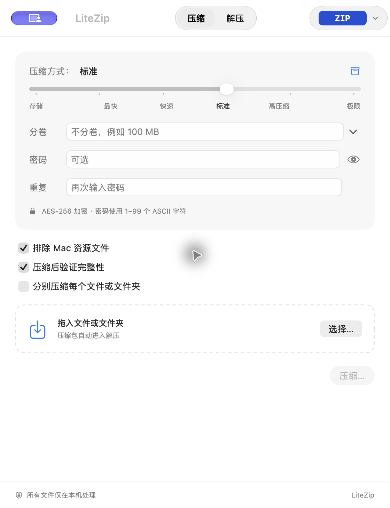

# LiteZip

免费开源的原生 Mac 压缩与解压工具。用来打包文件、给压缩包加密码、拆分大文件，或查看和解压收到的压缩包。文件始终在本机处理，无需账号。

**macOS 13+ · 支持 Apple Silicon 和 Intel**

[官网](https://litezip.app/) · [下载](https://github.com/gentpan/LiteZip/releases/tag/v0.6.2) · [用户反馈](https://litezip.app/feedback/) · [更新日志](https://litezip.app/changelog/)

## 能做什么

- **压缩与解压**：支持 ZIP、7Z、TAR 及常用压缩 TAR 格式，内置 RAR / RAR5 和 ZIPX 解压，支持 LZO 单文件压缩与解压，另可解压 CAB、CPIO、LZH、LZMA、Z。
- **加密与分卷**：为压缩包设置密码，把大文件拆成多个小包，方便保存和分享。
- **批量打包**：多个文件打成一个包，也可以分别压缩每个文件或文件夹。
- **查看压缩包**：先浏览目录、搜索文件或校验完整性，再决定是否解压。
- **更多格式**：制作 DMG、ISO；GZIP、BZIP2、XZ、ZSTD、LZIP、LZ4、Brotli、LRZIP、Snappy、AAR、WIM 等格式可直接解压。
- **菜单栏快捷压缩**：把文件或文件夹拖到菜单栏图标，或点击图标选择文件，即可使用选定格式打包；压缩时图标变为进度圆环。
- **Finder 右键操作**：右键直接压缩为 ZIP、7Z、TAR.GZ 或 RAR；压缩包可解压到原位置或选择的文件夹。

## 安装

1. 在[下载页面](https://github.com/gentpan/LiteZip/releases/tag/v0.6.2)获取 ZIP 安装包。
2. 解压后，将 `LiteZip.app` 拖入「应用程序」。
3. 打开 LiteZip，即可开始使用。

当前版本为 **0.6.2 开发预览版**，下载包已完成 Developer ID 签名与 Apple 公证。

## 怎么使用

### 压缩文件

1. 打开 LiteZip，在窗口右上角选择 ZIP、7Z 等格式。
2. 需要时点击右上角的调节按钮（或按 ⌘3）展开选项面板，设置压缩等级、密码或分卷大小。
3. 拖入文件或文件夹，点击「压缩」，选择保存位置。

勾选「分别压缩每个项目」后，每个文件或文件夹会生成独立的压缩包。

### 解压与预览

在 Finder 中右键压缩包，选择「解压到独立文件夹」或「解压到…」；也可以把压缩包拖到菜单栏图标，或在设置中把 LiteZip 设为默认打开方式后双击。结果会放在独立文件夹中，同名文件夹自动编号。

右键选择「在 LiteZip 中打开…」可以先预览压缩包内容、搜索文件或检查完整性。DMG、ISO 也可以从预览窗口挂载到 Finder。

### 常用设置

- **Finder 菜单**：在系统设置中搜索「Finder 扩展」，启用 **LiteZip Finder**。
- **分卷解压**：将全部分卷放在同一个目录，打开第一卷即可。
- **中文密码**：请选择 7Z；ZIP 密码支持英文字母、数字和常见符号，加密 ZIP 需要兼容 AES 的解压工具。
- **创建 RAR**：在设置中点击「下载官方引擎」，LiteZip 会从 RARLAB 官网获取[官方 RAR 引擎](https://www.rarlab.com/download.htm)并自动连接；也可以选择本机已有的 RAR 程序。官方引擎可试用 40 天，之后需向 RARLAB 购买许可。RAR 解压无需额外安装。
- **设置与更新**：点击菜单栏弹窗右下角的齿轮打开设置。弹窗右上角显示版本号，有新版本时变为绿色，点击即可更新；也可以在设置的「关于」页立即检查。

## 开发与许可

开发者可查看[构建与发布](docs/BUILDING.md)、[技术说明](docs/DEVELOPMENT.md)和[验证记录](docs/VALIDATION.md)。

LiteZip 自有代码采用 [MIT 许可](LICENSE)。内置引擎及其他组件的许可见[第三方声明](Resources/ThirdPartyNotices.txt)；官方 RAR 引擎使用独立许可。
